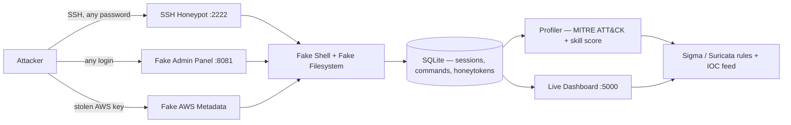

<div align="center">

# 🏗 GhostShell — Architecture

**How the trap works, end to end.**

</div>

---

## 🗺 The fake company

GhostShell is not one honeypot — it is a whole fake company that shares
one fake world: same users, same files, same credentials, everywhere.



---

## 🧩 Components

| File | Job |
|---|---|
| `ghostshell/honeypot.py` | Paramiko SSH server. Accepts **any** password or key — that is the trap. One thread per attacker. |
| `ghostshell/shell.py` | Fake shell. `ls`, `cat`, `ps`, `whoami`, `uname`, `sudo`, `curl`… Unknown commands go to the AI shell. |
| `ghostshell/fakefs.py` | The fake filesystem. Includes honeytoken files: `aws_credentials.txt`, `.ssh/id_rsa`, `database_backup.sql`. |
| `ghostshell/llm.py` | Local Ollama AI shell. No external API, no data leaves your machine. Falls back to rules when Ollama is off. |
| `ghostshell/services.py` | Fake admin panel + fake AWS metadata endpoint. Same fake AWS key as the SSH honeytoken. |
| `ghostshell/db.py` | SQLite. Tables: `sessions`, `commands`, `honeytoken_hits`, `http_attempts`. |
| `ghostshell/profiler.py` | Maps commands to MITRE ATT&CK tactics/techniques + skill score (bot / intermediate / skilled). |
| `ghostshell/rules.py` | Generates Sigma + Suricata rules from a session's own commands. |
| `ghostshell/dashboard.py` | Rich dark HTML dashboard: stats, session replay, MITRE profile, rules page, `/api/ioc`. |

---

## 🔄 Data flow — one attack, start to finish

```
1. Attacker SSHs in with admin / hunter123
        → honeypot.py accepts, db.new_session()
2. Attacker runs: ls, cat aws_credentials.txt, cat /etc/passwd
        → shell.py answers from fakefs.py
        → db.log_command() for every command
        → cat on a honeytoken → db.log_honeytoken()
3. Attacker tries the stolen AWS key on the metadata endpoint
        → services.py logs the attempt, returns the same fake key
4. Dashboard reads SQLite
        → profiler.py scores the session, maps MITRE tactics
        → /session/<id> replays the terminal
        → /rules/<id> generates Sigma + Suricata from the commands
        → /api/ioc exposes attacker IPs + honeytoken hits as JSON
```

---

## 🪤 Honeytokens — the canary files

| File | What it looks like | Signal |
|---|---|---|
| `/home/admin/aws_credentials.txt` | Real-looking AWS key pair | Attacker is after cloud creds |
| `/home/admin/.ssh/id_rsa` | Private SSH key | Attacker wants lateral movement |
| `/home/admin/database_backup.sql` | Prod DB dump with password hashes | Attacker wants data / creds |

Reading any of them is logged with timestamp, session and IP —
in the dashboard under **Honeytoken hits** and in `/api/ioc`.

---

## 🛡 From attack to detection

Every session can be turned into defence in one click:

- **Sigma rule** — paste into Splunk / Sentinel / Elastic
- **Suricata rule** — paste into your IDS
- **IOC feed** — `GET /api/ioc` — attacker IPs, ready to blocklist

The rules are generated from the attacker's *actual* commands,
not from a textbook list — so they match real behaviour.
